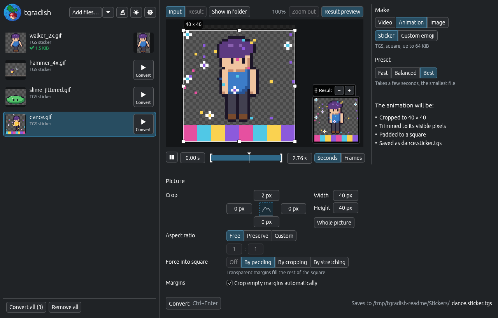

# tgradish

Telegram video, image and animated stickers and emoji from videos, pictures and pixel art, in a window or on the command line:

- video stickers and emoji (WebM) from any video, GIF, picture, Aseprite file or folder of frames;
- animated stickers and emoji (.tgs) from pixel art: GIF, APNG, WebP, Aseprite, a sprite sheet, a folder of frames, or a video of it;
- image stickers and emoji (WebP) from a picture, or a frame of a video or animation.

Video stickers and emoji can run past Telegram's 3 second limit: tgradish spoofs the duration written in the file so Telegram accepts them.




## Installation

From [Releases](https://github.com/sliva0/tgradish/releases):

- **Linux** (x86-64 and aarch64): a single binary with ffmpeg built in, for glibc (`linux-gnu`) or musl (`linux-musl`), one for glibc that uses the system's ffmpeg (`system-ffmpeg`), or `.deb` and `.rpm` packages with ffmpeg built in:
  ``` console
  sudo apt install ./tgradish_2.0.0-1_amd64.deb
  sudo dnf install ./tgradish-2.0.0-1.x86_64.rpm
  ```
- **Windows** (x86-64): a zip with `tgradish.exe`, ffmpeg built in.

macOS is untested and not supported.

Arch Linux, from the AUR: `tgradish` builds from source, `tgradish-bin` is the release build using the system's ffmpeg, and `tgradish-static-bin` the one with ffmpeg built in:
``` console
yay -S tgradish-bin
```

Nix:
``` console
nix run github:sliva0/tgradish
```

From source, with Rust 1.95 or newer, `cargo build --release` makes `target/release/tgradish`, which uses the system's ffmpeg; [CONTRIBUTING.md](CONTRIBUTING.md) says how to build it with ffmpeg built in.

The Python version, 1.x, is on the [`1.x`](https://github.com/sliva0/tgradish/tree/1.x) branch and on PyPI. 2.0's command line is different: `convert` takes its inputs as arguments, without `-i`.


## Dependencies

Video and image stickers are made with ffmpeg, as are .tgs stickers from videos; those from pixel art, `tgradish spoof` and `tgradish inspect` work without it.

Builds with ffmpeg built in need no separate ffmpeg. The rest use `ffmpeg` and `ffprobe` from PATH, with libvpx; the Nix package brings its own. Which one is used can be changed in Settings or with `--ffmpeg-from` and `--ffmpeg`, and `tgradish ffmpeg` shows which it is and whether it can make stickers.


## Usage examples

`tgradish` opens the window when started without arguments outside a terminal, as does `tgradish gui`. Everything the window does can be done on the command line too: `tgradish --help` lists the commands, and `tgradish <command> --help` their options.

``` console
tgradish convert clip.mp4                  # a video sticker, clip.sticker.webm
tgradish convert clip.mp4 --target emoji   # an emoji, clip.emoji.webm
tgradish convert walk.ase -f tgs           # an animated sticker, walk.sticker.tgs
tgradish convert photo.jpg -f webp         # an image sticker, photo.sticker.webp
tgradish watch ~/Videos -O ~/Stickers      # each new video or picture as it comes
tgradish inspect clip.sticker.webm         # what Telegram would say of it
tgradish spoof ready.webm                  # a WebM made elsewhere, spoofed: ready.spoofed.webm
```

From an Aseprite file, only its `idle` tag, with its `sketch` layer hidden:
``` console
tgradish convert walk.ase -f tgs --tag idle --hide-layers sketch
```


## Scripting

Switches a preset can set come in pairs, as `--exact` and `--no-exact`. `--json` prints JSON Lines, and `tgradish describe` gives the schemas of the events `convert` and `watch` print. The exit status is 0 when done, 1 when something failed, 2 when the command line was wrong, 3 when everything was made but Telegram would refuse a result, and 130 when `convert` is cancelled; a cancelled `watch` ends with 0.


## Contributing

[CONTRIBUTING.md](CONTRIBUTING.md) explains how the crates fit together, how to build and test every variant, and how to make a release.


## Licence

[MIT License](LICENSE.txt). Builds with ffmpeg built in also carry ffmpeg under the LGPL, its sources attached to each release; `tgradish licenses` prints every notice a build carries, and About in the window shows them.
