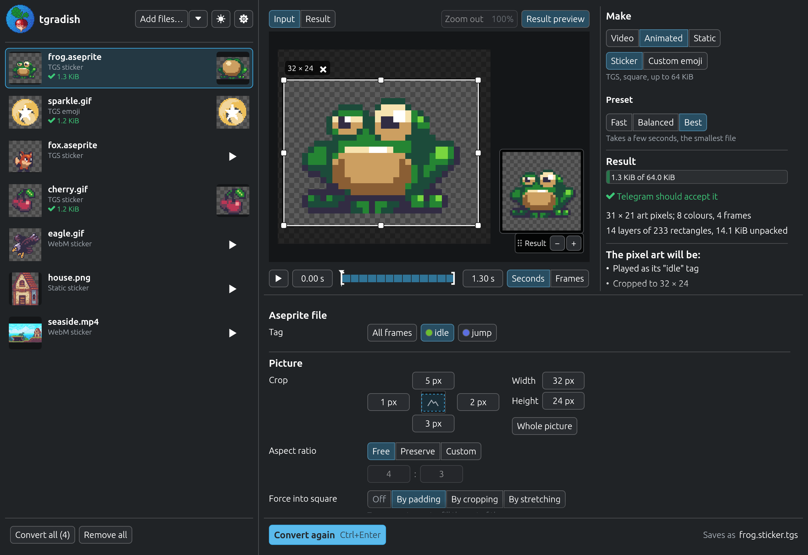

# tgradish

Telegram video, static and animated stickers and emoji from videos, images or pixel art, in a GUI or on the command line:

- video stickers and emoji (WebM) from any video, GIF or picture;
- animated stickers and emoji (.tgs) from pixel art: GIF, APNG, WebP, Aseprite, a sprite sheet or a folder of frames;
- static stickers and emoji (WebP) from a picture, or a frame of a video.

Video stickers and emoji can run past Telegram's 3 second limit: tgradish spoofs the duration written in the file so Telegram accepts them.




## Installation

Every release is on [Releases](https://github.com/sliva0/tgradish/releases); the links below take the latest.

### Windows

x86-64: [tgradish-windows-x86_64.zip](https://github.com/sliva0/tgradish/releases/latest/download/tgradish-windows-x86_64.zip), with ffmpeg built in. Unpack it and run `tgradish.exe`.

Or [tgradish.exe](https://github.com/sliva0/tgradish/releases/latest/download/tgradish.exe) alone, the same program: `tgradish licenses` prints the notices the zip has as files.

### Linux

x86-64 and aarch64: `$(uname -m)` picks the file for the machine.

- **Debian, Ubuntu, Mint** and other Debian-based, with ffmpeg built in:
  ``` console
  wget https://github.com/sliva0/tgradish/releases/latest/download/tgradish-linux-$(uname -m).deb
  sudo apt install ./tgradish-linux-$(uname -m).deb
  ```
- **Fedora, openSUSE** and other rpm-based, with ffmpeg built in:
  ``` console
  curl -LO https://github.com/sliva0/tgradish/releases/latest/download/tgradish-linux-$(uname -m).rpm
  sudo dnf install ./tgradish-linux-$(uname -m).rpm
  # or on openSUSE
  sudo zypper install --allow-unsigned-rpm ./tgradish-linux-$(uname -m).rpm
  ```
- **Arch Linux**, from the AUR: `tgradish` builds from source, `tgradish-bin` uses the system's ffmpeg, `tgradish-static-bin` has it built in:
  ``` console
  yay -S tgradish-bin
  ```
- **NixOS, Nix**, with nixpkgs' ffmpeg; on NixOS the flake's `overlays.default` adds `pkgs.tgradish`:
  ``` console
  nix run github:sliva0/tgradish               # once
  nix profile install github:sliva0/tgradish   # to keep
  ```
- **Any Linux** with glibc 2.28 or newer, from an archive with ffmpeg built in:
  ``` console
  curl -L https://github.com/sliva0/tgradish/releases/latest/download/tgradish-linux-$(uname -m).tar.gz | tar -xz
  install -Dm755 tgradish-*/tgradish ~/.local/bin/tgradish
  ```
  For musl, as on Alpine, take `tgradish-linux-musl-$(uname -m).tar.gz` instead, or `tgradish-linux-$(uname -m)-system-ffmpeg.tar.gz` to use the system's ffmpeg. The archives also have a menu entry, icons, man pages and shell completions.
- **Cargo**, with Rust 1.95 or newer and a C compiler, using the system's ffmpeg:
  ``` console
  cargo install tgradish
  ```
- **From source**, likewise:
  ``` console
  git clone https://github.com/sliva0/tgradish
  cd tgradish
  cargo install --locked --path crates/cli
  ```

### macOS

Untested and not supported: no release is built for it. Building from source might work, with Homebrew's ffmpeg:
``` console
brew install ffmpeg rust
cargo install tgradish
```

The Python version, 1.x, is on the [`1.x`](https://github.com/sliva0/tgradish/tree/1.x) branch and on PyPI. Its command line was different: see [CHANGELOG.md](CHANGELOG.md).


## Dependencies

Release builds have ffmpeg built in, as does `tgradish-static-bin`, but not the archives named `system-ffmpeg`. Those, the other AUR packages, Nix's and builds with cargo run `ffmpeg` and `ffprobe` from PATH, with libvpx, which the AUR and Nix packages install with them; `tgradish ffmpeg` shows which is used and whether it can make stickers.

Animated stickers from pixel art, `tgradish spoof` and `tgradish inspect` work without ffmpeg.


## Usage examples

`tgradish gui [FILES]` opens the GUI, as does starting `tgradish` from a file manager or a menu. F1 lists its keyboard shortcuts.

On the command line:

``` console
tgradish convert clip.mp4                  # a video sticker, clip.sticker.webm
tgradish convert clip.mp4 --target emoji   # an emoji, clip.emoji.webm
tgradish convert walk.ase -f tgs           # an animated sticker, walk.sticker.tgs
tgradish convert photo.jpg -f webp         # a static sticker, photo.sticker.webp
tgradish watch ~/Videos -O ~/Stickers      # each new video or picture as it comes
tgradish inspect clip.sticker.webm         # what Telegram would say of it
tgradish spoof ready.webm long.webm        # a WebM made elsewhere, spoofed into long.webm
```

From an Aseprite file, only its `idle` tag, with its `sketch` layer hidden:
``` console
tgradish convert walk.ase -f tgs --tag idle --hide-layers sketch
```

`tgradish --help` lists the commands, and `tgradish <command> --help` their options. `tgradish config example` prints a config file to start from, each setting explained.


## Scripting

`--json` prints JSON Lines, and `tgradish describe` gives the schemas of its events and options. `-q` prints only the paths of the files made.

The exit status is 0 when done, 1 when something failed, 2 when the command line was wrong, 3 when everything was made but Telegram would refuse a result, and 130 when `convert` is cancelled.


## Contributing

See [CONTRIBUTING.md](CONTRIBUTING.md). Feedback: [@s0untitled](https://t.me/s0untitled?direct) on Telegram, or open an issue.


## Licence

[MIT License](LICENSE.txt). Builds with ffmpeg built in also carry ffmpeg under the LGPL, its sources attached to each release; `tgradish licenses` prints every notice a build carries.
