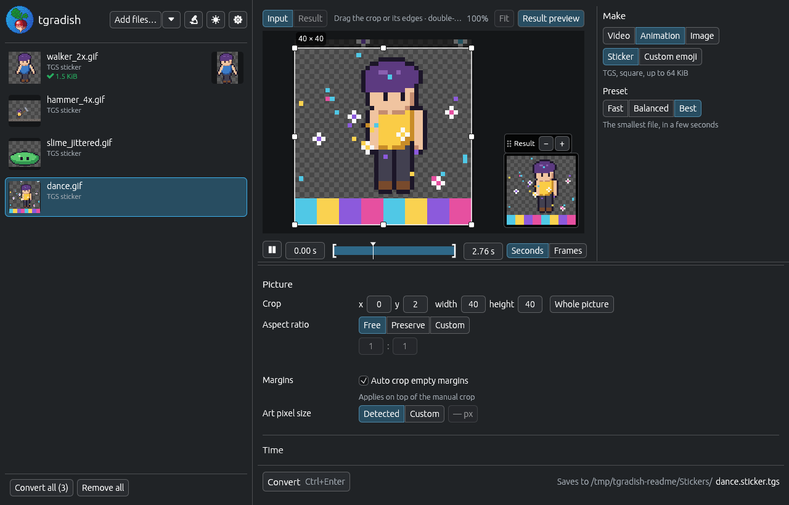

# tgradish

Telegram stickers and emoji from videos, pictures and pixel art, in a window or on the command line, with the ability to bypass the 3 second limit:

- video stickers and emoji (WebM) from any video, GIF or picture;
- animated stickers (.tgs) from pixel art: GIF, APNG, WebP, Aseprite or a folder of frames;
- image stickers and emoji (WebP) from a picture or a frame of a video.




## Installation

From [Releases](https://github.com/sliva0/tgradish/releases):

- **Linux** (x86-64 and ARM64): a single binary with ffmpeg built in, one that uses the system's ffmpeg, or `.deb` and `.rpm` packages:
  ``` console
  sudo apt install ./tgradish_2.0.0-1_amd64.deb
  sudo dnf install ./tgradish-2.0.0-1.x86_64.rpm
  ```
- **Windows** (x86-64): a zip with `tgradish.exe`, ffmpeg built in.

Arch Linux, from the AUR: `tgradish` builds from source, `tgradish-bin` is the release build using the system's ffmpeg, and `tgradish-static-bin` the one with ffmpeg built in:
``` console
yay -S tgradish-bin
```

Nix:
``` console
nix run github:sliva0/tgradish
```

From source, with Rust:
``` console
cargo install --git https://github.com/sliva0/tgradish tgradish
```

The Python version, 1.x, is on the [`1.x`](https://github.com/sliva0/tgradish/tree/1.x) branch and on PyPI.


## Dependencies

Video and image stickers are made with ffmpeg; animated .tgs stickers, `tgradish spoof` and `tgradish inspect` work without it.

The release builds with ffmpeg built in, the `.deb` and `.rpm` packages and `tgradish-static-bin` need nothing else. The other builds, `cargo install` included, use `ffmpeg` and `ffprobe` from PATH; the Nix package brings its own.

Which one is used can be changed in Settings or with `--ffmpeg-from` and `--ffmpeg`, and `tgradish ffmpeg status` shows which it is and whether it can make stickers. Raw ffmpeg arguments (`--extra-args`) need ffmpeg as a separate program.


## Usage examples

`tgradish` opens the window when started outside a terminal, as does `tgradish gui`. Everything the window does can be done on the command line too: `tgradish --help` lists the commands, and `tgradish convert --help` all the options.

Converting a video into a video sticker, `pig.sticker.webm` next to it:
``` console
tgradish convert ~/pig.mp4
```

An animated sticker from pixel art:
``` console
tgradish convert ~/walker.gif --format tgs
```


## Contributing

[CONTRIBUTING.md](CONTRIBUTING.md) explains how the crates fit together, how to build and test every variant, and how to make a release.


## Licence

[MIT License](LICENSE.txt). Builds with ffmpeg built in also carry ffmpeg under the LGPL, its sources attached to each release; `tgradish licences`, or About in the window, lists everything a build contains.
